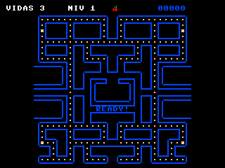

# Emulador FPGA 6502

Emulador del computador **fpga-6502-16k** (Sipeed Tang Nano 9K, Gowin GW1NR-9),
pensado para **desarrollar y depurar software** para esa plataforma.

**Guía completa: [`docs/GUIA-USO.md`](docs/GUIA-USO.md)**

Otros documentos:

- [`docs/PROCEDIMIENTOS.md`](docs/PROCEDIMIENTOS.md) — cómo se midió y verificó
  cada periférico, y las trampas encontradas.
- [`docs/PUTTY-SETUP.md`](docs/PUTTY-SETUP.md) — configuración del terminal.

---

## Arranque rápido

```bash
# En MSYS2 UCRT64
cd /d/Proyectos/EmuladorFpga6502
make -j4          # requiere SDL2 para audio/vídeo (opcional)
./run.sh          # ROM + tarjeta.img + UART en 4000 (sin depuracion)
./run_debug.sh    # igual, pero con la depuracion HTTP en 8080
```

Conecta por **PuTTY / ExtraPuTTY**:

| Ajuste | Valor |
|---|---|
| Connection type | **Raw** |
| Host / Port | `localhost` / `4000` |
| Session → Terminal-type string | `xterm` |
| Session → Data → **Local echo** | **Force off** |
| Session → Data → **Local line editing** | **Force off** |

Y abre en el navegador **<http://localhost:8080>** para ver el vídeo en vivo.

---

## Qué emula

| Componente | Estado | Notas |
|---|---|---|
| CPU 6502 | ✅ | 151 opcodes, ciclos reales por instrucción |
| RAM 16 KB + ROM 16 KB | ✅ | monitor v2.6.2, vectores mapeados |
| UART | ✅ | fiel a `uart.vhd`, entrega a ritmo serial |
| SD / SPI | ✅ | protocolo SD completo, formato MicroFS |
| Timer / RTC | ✅ | contadores con latch, 6.75 MHz |
| SID 6581 | ✅ | **reSIDfp** (VICE), reloj 27 MHz/28 |
| Core de Vídeo | ✅ | tiles, sprites, scroll por bandas, paletas |
| GPIO | ✅ | joystick Atari (puerto 1) + 6 LEDs (puerto 2) |
| Ventana SDL2 | ✅ | vídeo escalado + panel de LEDs |
| Entrada | ✅ | teclado, mando del PC o comandos por UART |
| Ritmo | ✅ | CPU 3.375 MHz reales, vídeo 59,94 Hz, timer en µs |
| Audio SDL2 | ✅ | ring buffer con colchón de 60 ms |

---

## Depuración (importante para desarrollo)

Servidor HTTP que se activa con el lanzador **`run_debug.sh`** (o con
**`--debug`** si arrancas el `.exe` directamente). Con `run.sh` no se abre:

```bash
./run_debug.sh                       # http://localhost:8080
./run_debug.sh 4000 tarjeta.img 9000 # otro puerto de depuracion
```

En Windows: `run_debug.bat` (y `run.bat` sin depuración).

| URL | Contenido |
|---|---|
| `/` | Vista previa del vídeo + estado, refresco automático |
| `/screen.png` | Captura exacta de lo que saldría por HDMI (320×240); `?scale=2` para ampliar |
| `/screen.ppm` | La misma imagen sin comprimir |
| `/vram.txt` | Tilemap, atributos y OAM en texto (+ vista ASCII) |
| `/vram.json` | Lo mismo en JSON, para procesarlo con código |
| `/state.txt` | GPIO (joystick, LEDs), vídeo, SID y UART |
| `/ram.bin` | Los 16 KB de RAM (`?start=&len=` para un trozo) |

Permite inspeccionar lo que genera tu programa **sin capturas manuales**, también
desde un agente de IA o un test automático:

```bash
curl -o pantalla.png http://localhost:8080/screen.png
curl -o pantalla_grande.png "http://localhost:8080/screen.png?scale=2"
```

---

## Ejemplo: cargar un juego

En el terminal:

```
load PACMAN.BIN 0800
r 0800
```

Y mira `http://localhost:8080/` para ver el resultado:



> La dirección de carga **debe** coincidir con la de enlace del binario. El SID
> player, por ejemplo, se carga en `2700`, no en `0800`. Cargarlo mal no da
> error: el programa ejecuta basura y no imprime nada.

---

## Controles

El joystick Atari del puerto 1 se maneja desde la ventana:

| Acción | Teclado | Mando conectado al PC |
|---|---|---|
| Mover | Cursores o **WASD** | Stick izquierdo o cruceta |
| Fuego | **Espacio**, Z, Ctrl izq. o Intro | A/B/X/Y, hombros o gatillos |

Las dos fuentes conviven, y los comandos por UART siguen funcionando en
paralelo (cada juego define sus teclas).

Mapa de pines del joystick (activo en bajo, en reposo `0xF8`):

| Señal | Bit | Máscara | Pin |
|---|---|---|---|
| derecha | 3 | `0x08` | 40 |
| izquierda | 4 | `0x10` | 34 |
| abajo | 5 | `0x20` | 33 |
| arriba | 6 | `0x40` | 30 |
| fuego | 7 | `0x80` | 29 |

---

## Problemas conocidos

**El sonido va por detrás del vídeo.** Casi siempre es el **dispositivo de
audio**, no el emulador. Si el predeterminado de Windows es un dispositivo
virtual (Steam Streaming, Nahimic), añade decenas o cientos de milisegundos que
el emulador no puede compensar. El emulador marca los virtuales al arrancar y
avisa. Fuerza el físico:

```bash
EMU_AUDIO_DEVICE="Altavoces (Realtek(R) Audio)" ./run.sh
```

Lo que sí controla el emulador son ~42 ms (colchón del búfer + período del
callback).

**El emulador se cierra solo al lanzarlo desde un script.** No es un fallo: el
shell mata el grupo de procesos al terminar la llamada. Si lo lanzas con
`./emulador.exe ... &` desde una llamada de terminal o desde un script, el
proceso desaparece al acabar esa llamada, sin ningún mensaje de error.

Para probarlo automáticamente, lanzarlo desacoplado:

```bash
powershell -Command "Start-Process -FilePath '.\emulador.exe' -ArgumentList \
  'rom/monitor.bin','4000','tarjeta.img','--debug' -WindowStyle Normal"
```

Desde `run.sh` / `run_debug.sh` en una terminal normal no ocurre.

---

## Requisitos

- **MSYS2 + MinGW-w64 UCRT64**
- Opcional, para audio y ventana:

```bash
pacman -S --needed mingw-w64-ucrt-x86_64-SDL2
make clean && make
make info     # debe mostrar: SDL2: 1
```

Sin SDL2 el emulador funciona igual (sin ventana ni sonido).

---

## Estructura

```
src/
  main.cpp             bucle principal (3.375 MHz reales)
  cpu_6502.*           CPU 6502
  cpu_cycles.h         tabla de ciclos por opcode
  bus.*                mux de dispositivos + IRQ
  ram_rom.*            RAM + ROM
  uart.*               UART $C020-$C023
  spi_sd.*, sd_card.*  SPI + tarjeta SD (MicroFS)
  timer.*              timer/RTC $C030-$C03F
  sid.*                SID sobre reSIDfp
  gpio_uart.*          GPIO $C000-$C003 (joystick + LEDs)
  audio.*              salida de audio SDL2
  emu_window.*         ventana: vídeo + 6 LEDs
  tcp_server.*         UART <-> TCP
  debug_server.*       servidor HTTP de depuración (no bloquea la emulación)
  debug_dump.*         PNG/PPM/JSON/texto y volcado de RAM
  video/               motor del Core de Vídeo
third_party/residfp/   núcleo SID de VICE (GPL v2+)
tools/                 gen_font, extract_rom, sd_tool, diag_rx, crear_sd.sh
rom/monitor.bin        ROM del monitor v2.6.2
sdcard/                contenido de la SD (la imagen se regenera con tools/crear_sd.sh)
run.sh / run.bat             lanzadores (sin depuracion)
run_debug.sh / run_debug.bat  lanzadores con depuracion HTTP
```

La imagen `tarjeta.img` (16 MB) no se versiona. Se reconstruye desde `sdcard/`:

```bash
./tools/crear_sd.sh        # crea tarjeta.img con los ficheros de sdcard/
```

---

## Documentación relacionada

- [`docs/GUIA-USO.md`](docs/GUIA-USO.md) — guía completa: ejecución, depuración,
  mapa de memoria, cómo emula cada periférico y solución de problemas.
- [`docs/PROCEDIMIENTOS.md`](docs/PROCEDIMIENTOS.md) — cómo se verificó cada
  parte y las trampas encontradas al depurar.
- [`docs/PUTTY-SETUP.md`](docs/PUTTY-SETUP.md) — configuración del terminal.
- `../fpga-6502-16k/docs/07-MANUAL-PROGRAMACION.md` — manual de programación del
  hardware original (vídeo, registros, paletas).

---

## Licencia

Este proyecto se distribuye bajo **GNU General Public License v2 o posterior**
(ver [`LICENSE`](LICENSE)).

La razón es que incluye **reSIDfp** (`third_party/residfp/`), el núcleo del SID
usado por VICE, que está bajo GPL v2+. Al distribuir el programa con ese código,
la obra completa queda sujeta a la misma licencia.

### Créditos

| Componente | Autor / origen | Licencia |
|---|---|---|
| reSIDfp | Leandro Nini, Antti Lankila, Dag Lem | GPL v2+ |
| SDL2 | Sam Lantinga / SDL | zlib |
| Monitor, FPGA y Core de Vídeo | proyecto `fpga-6502-16k` | ver su repositorio |
| Pacman y SID player | proyectos propios incluidos en `sdcard/` | — |
